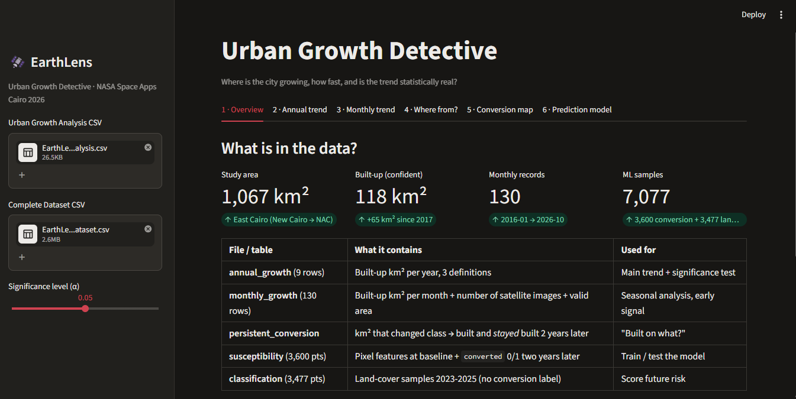

# 🛰️ EarthLens: Urban Growth Detective

**NASA Space Apps Challenge 2026 · Cairo · Challenge: Earth System Trend Detective**

Is the city growing, how fast, and is the trend statistically real? EarthLens measures built-up area across a ~1,067 km² study region in **eastern Greater Cairo** (New Cairo and the desert corridor toward Suez, about 31.36–31.97°E, 29.87–30.11°N) from 2016 to 2025. It removes the seasonal cycle, tests the trend, screens data quality, finds what land the city grew onto, and compares the result with NASA night-time lights.

TEAM: TheOutliers



## Headline result

| Measure | Value |
|---|---|
| Annual built-up growth (Theil-Sen) | **+8.6 km²/year** (95% CI 7.6 to 9.7) |
| Annual trend test (exact Kendall) | tau = 1.0, p = 5.5e-06 (n = 9 years; see limitation 2) |
| Season-matched monthly slope | about +9 km²/year, year-block permutation p < 0.0001 |
| STL residuals (Ljung-Box, 12 lags) | p = 0.18, no significant autocorrelation left |
| Built-up area, 2017 → 2025 | 53.3 → 118.5 km² (+122%) |
| NASA night lights, 2017 → 2025 | +161%, **provisional**: computed on an approximate region (see limitation 3) |

Primary metric: `Confident_Built_km2` (area where Dynamic World's built probability is at least 0.5).

## Data: what we used and how we got it

**Sources**
- **Google Dynamic World V1** (`GOOGLE/DYNAMICWORLD/V1`): per-pixel land-cover probabilities and labels from a deep-learning model on Sentinel-2. "Built-up area" in this project is therefore a **model output, not a direct measurement**.
- **Sentinel-2 SR Harmonized** (`COPERNICUS/S2_SR_HARMONIZED`): cloud-masked bands B2, B3, B4, B8, B11, B12, plus NDVI, NDBI and BSI, used as features for the prediction model.
- **NASA VIIRS Black Marble** (`NASA/VIIRS/002/VNP46A2`): night-time lights, used only for the Step 8 cross-check.

**How the two CSVs in `data/` were produced**
1. We drew the study area as a 9-point polygon in the Google Earth Engine Code Editor (about 1,067 km²).
2. A single Earth Engine script computed everything at 30 m resolution and exported two CSVs to Google Drive:
   - `EarthLens_Urban_Growth_Analysis.csv`: monthly rows (2016 to 2026-10), annual rows (2017 to 2025, from the annual median of built probability) and persistent-conversion rows.
   - `EarthLens_Complete_Dataset.csv`: sampled points with Dynamic World probabilities, Sentinel-2 bands and indices, and labels. Classification samples are pooled over 2023–2025; susceptibility samples cover 2-year transitions from 2017→2019 to 2023→2025.
3. Thresholds used: built = probability ≥ 0.50 (target year), ≥ 0.40 (intermediate year), non-built = < 0.30. Samples are stratified at 300 points per class.

The extraction script itself is not included in this folder.

## Project layout

```
EarthLens/
├── app.py                  Streamlit app (6 tabs, incl. ML susceptibility model)
├── requirements.txt
├── data/                   the two CSVs exported from Earth Engine (never modified)
│   ├── EarthLens_Urban_Growth_Analysis.csv   annual, monthly and persistent-conversion records
│   └── EarthLens_Complete_Dataset.csv        classification + susceptibility samples (points)
├── notebooks/
│   └── steps1-4_trend_and_stl.ipynb          load/validate, annual & monthly trend, STL decomposition
├── scripts/
│   ├── step5_statistical_tests.py            Kendall, Theil-Sen, permutation test, Ljung-Box
│   ├── step6_data_quality.py                 coverage / image-count screening, metric sensitivity
│   ├── step7_land_conversion.py              persistent land conversion + sample maps
│   └── step8_nasa_black_marble.py            NASA night-lights comparison (needs Earth Engine)
├── outputs/                results of each step (steps1-4, step5 … step8): CSVs and PNGs
├── dashboard/              dashboard in two versions, built on the same five CSVs
│   ├── dashboard.html      standalone HTML version
│   └── powerbi/            Power BI Desktop version (.pbip project)
└── docs/                   screenshots and dashboard design notes
```

## Quick start

```bash
python -m venv .venv
source .venv/bin/activate        # Windows: .venv\Scripts\activate
pip install -r requirements.txt
```

### 1. Streamlit app
```bash
streamlit run app.py
```
Data loads automatically from `data/`; you can also upload your own copies from the sidebar. Tabs: Overview, Annual trend, Monthly trend, Where from? (source land classes), Conversion map, Prediction model.

### 2. Analysis scripts
Run from anywhere; results are written to `outputs/`.
```bash
python scripts/step5_statistical_tests.py
python scripts/step6_data_quality.py
python scripts/step7_land_conversion.py
```
The notebook covers steps 1–4 and can be run with Jupyter from any folder.

### 3. NASA Black Marble (Step 8, optional)
Needs a Google Earth Engine account and project.
```bash
pip install earthengine-api
earthengine authenticate
python scripts/step8_nasa_black_marble.py --check                      # offline input check
python scripts/step8_nasa_black_marble.py --project YOUR_GEE_PROJECT   # approximate region
python scripts/step8_nasa_black_marble.py --project YOUR_GEE_PROJECT --roi study_area.geojson   # exact boundary (recommended)
```
Without `--roi`, the script uses a convex hull of the sample points, not the real study boundary. To use the exact boundary, save the study polygon as a GeoJSON file and pass it with `--roi`.

### 4. HTML dashboard
Browsers block `fetch()` on `file://`, so serve the folder:
```bash
cd dashboard
python -m http.server 8000
# open http://localhost:8000/dashboard.html
```
If you open the file directly, it falls back to a file picker: select all five CSVs in `dashboard/`.

### 5. Power BI dashboard
`dashboard/powerbi/EarthLens_Urban_Growth.pbip` is the same dashboard rebuilt in Power BI Desktop, using the same five CSVs in `dashboard/`. Use whichever version you prefer.

Open the `.pbip` file in Power BI Desktop (Windows). Keep the `.Report` and `.SemanticModel` folders next to it. If the data sources show as missing, go to Transform data → Data source settings and point them at the CSVs in `dashboard/`. If Power BI will not open the project, enable the Power BI Project (.pbip) option under File → Options → Preview features.

## Method in one paragraph

Monthly built-up area swings by roughly 3x between its lowest and highest calendar month. That swing is much larger than the decade's trend, so raw monthly data is misleading. EarthLens (1) decomposes the series with robust STL, (2) tests the annual series with exact Kendall and sizes it with Theil-Sen, (3) tests the monthly series season-by-season with a year-block permutation test, and (4) screens months with low coverage (< 95%) or few images (< 4) to show the result does not hinge on poor observations (screened slope 9.08 vs 9.05 km²/year).

## Data notes

- `-999` means "not applicable" in the source CSVs; the app converts it to NaN.
- `Record_Type` values: `annual_growth`, `monthly_growth`, `persistent_conversion`.
- The monthly rows run to 2026-10. The scripts use 2016–2025 only. In the app's Monthly tab, tick **Exclude partial year 2026** to match the scripts (the slope barely changes: +9.11 vs +9.12 km²/yr).
- Metrics: `Confident_Built_km2` (recommended), `Built_Probability_km2` (includes mixed pixels), `Modal_Built_km2` (annual only).
- `Complete_Dataset` rows have `task` = `classification` (land-cover samples, 2023–2025) or `susceptibility` (did a pixel become built-up).

## Limitations

1. **Modelled, not surveyed.** Built-up area is a Dynamic World estimate, and its monthly values swing with the season, so we rely on annual and deseasonalized results.
2. **Short series.** There are only 9 annual points, so we report the slope and its confidence interval rather than tau = 1.0.
3. **Night lights are a cross-check, not proof.** They measure lighting rather than buildings, and Step 8 used an approximate region (re-run with `--roi` for the exact boundary).
4. **Conversion is partial.** The strict rule and overlapping 2-year windows capture only part of the growth and cannot be summed; sample points support modelling, not area estimates.
5. **The prediction model learns Dynamic World's labels,** so its accuracy is not independent validation.

